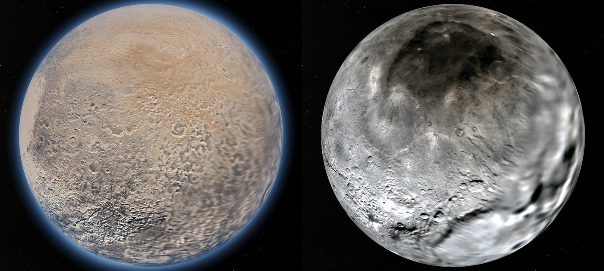
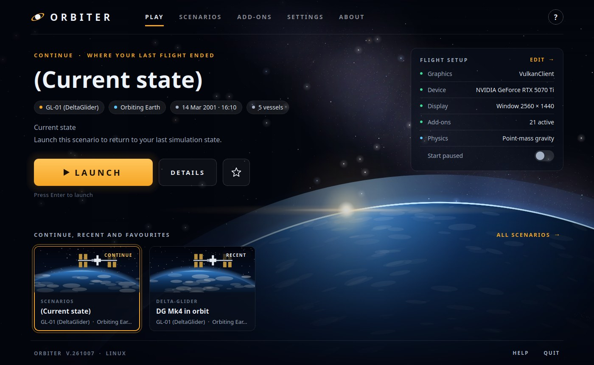
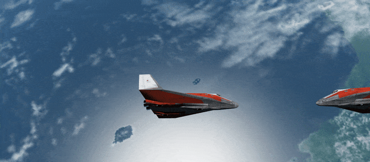
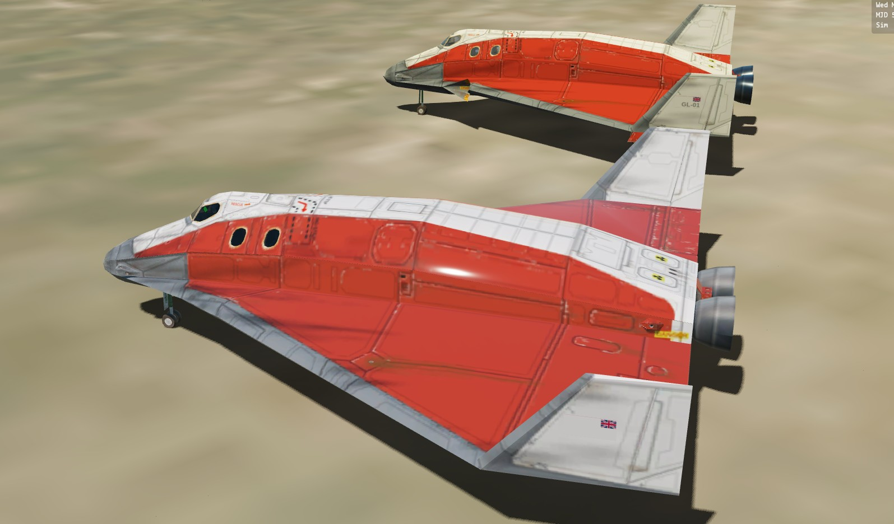

# Orbiter 2027 Space Flight Simulator — native Linux port+

Orbiter is a spaceflight simulator based on Newtonian mechanics. Its playground
is our solar system with many of its major bodies – the sun, planets and moons.
You take control of a spacecraft – either historic, hypothetical, or purely
science fiction. Orbiter is unlike most commercial computer games with a space
theme – there are no predefined missions to complete (except the ones you set
yourself), no aliens to destroy and no goods to trade. Instead, you will get a
pretty good idea about what is involved in real space flight – how to plan an
ascent into orbit, how to rendezvous with a space station, or how to fly to
another planet. It is more difficult, but also more of a challenge. Some people
get hooked, others get bored. Finding out for yourself is easy – simply give it
a try. Orbiter is free, so you don’t need to invest more than a bit of your
spare time.

This tree is the Linux-only code of a line-by-line port of [orbitersim/orbiter](https://github.com/orbitersim/orbiter)
(commits in `UPSTREAM`, via [racerx2/orbiter-2027-Linux](https://github.com/racerx2/orbiter-2027-Linux)) to native Linux: no Wine, no DXVK, graphics on Vulkan 1.3,
windows and dialogs on Qt 6, sound on PipeWire. It holds no Windows code; Orbiter for
Windows is [orbitersim/orbiter](https://github.com/orbitersim/orbiter).

## What's new since the Windows version

### Planets and moons



*Pluto, with its thin nitrogen atmosphere and blue haze, and Charon.*

- **The Pluto system**: Pluto, Charon, Nix, Hydra, Kerberos and Styx, which Orbiter never had.
- **New ephemeris modules** for Phobos, Deimos, Miranda, Ariel, Umbriel, Titania, Oberon and Triton (Windows has
  them only as 32-bit binaries), and better orbits for Hyperion, Proteus, Nereid and Vesta.
- **Spin axes and prime meridians** from the IAU rotation model.
- **Every planet and moon on the tile renderer**, with new maps for Mercury, Saturn, Uranus, Triton, Pluto and
  Charon. The textures are a separate download
  ([Orbiter-linux-orbital-bodies-textures](https://github.com/racerx2/Orbiter-linux-orbital-bodies-textures));
  the Launchpad offers to download and install the missing ones.
- **Measured atmospheres** for every body that has one, so drag and aerobraking use real densities.

### Launchpad skins



Change how the Launchpad looks without changing what it does. Pick a skin under **Extra > Launchpad skin**:

- **Dark**: a dark style sheet for the classic Launchpad.
- **Horizon** (above) and **Planetary Defense**: complete new launchers, made as Qt Designer forms.
- **Your own**: copy a skin, or make a new layout of the stock Launchpad, and edit it in Qt Designer.
  See [Skins/README.md](./Skins/README.md).

Ctrl+Shift+L always brings back the classic Launchpad.

### Collisions and damage



*Two Delta Gliders hit head-on at 70 m/s in orbit.*

An add-on that makes ships collide with each other, with base buildings and with the ground:

- Colliders follow each ship's real mesh, so cargo bays stay open.
- Docked and attached stacks respond as one body, and every impact conserves momentum.
- Hulls dent, crush and tear where they hit, sized by the crash energy.
- Structures break apart live in the simulation with NVIDIA Blast, on the CPU (no special graphics card needed).
  Pieces that come off fly away as debris.
- Crashes into buildings and into the ground do the same damage.
- Damage and debris are saved with the scenario and play back in flight recordings.
- A ship that absorbs more than 1 kJ per kg is destroyed (it loses thrust when the Damage model option is on).

Turn it on in the Launchpad's **Modules** tab (Collision). Settings are in `Config/Collision.cfg`.

### glTF models and PBR materials



*A Delta Glider exported from Blender as a .glb, with PBR materials, next to the stock Delta Glider (GL-01).*

Ships no longer have to be converted to Orbiter's `.msh` format:

- **Straight from Blender**: export glTF Binary (`.glb`, +Y Up on) or `.gltf`, put it in a folder under `Meshes`
  and name it in the vessel's cfg, for example `MeshName = MyShip\myship.glb`. A `.glb` carries its textures
  inside, so there is no converter, no texture folder and no material file to write. In Blender the nose points
  along +Y and the top along +Z.
- **Every glTF PBR material feature**: base colour and alpha (opaque, cut-out, transparent), metallic and
  roughness, normal maps, emission with strength, ambient occlusion, IOR and specular, transmission and volume
  (tinted glass), clearcoat (car paint), sheen (fabric), anisotropy (brushed metal) and iridescence (thin-film
  colours).
- **Lit by the simulation**: the sun with shadows, the ship's own lights, and reflections of its surroundings.
- **Glass seen through glass**: a HUD behind the canopy, a visor inside a helmet, or another ship's windows
  behind your own now show through, tinted by the glass in front. Glass shows what is behind it by bending a
  copy of the screen. That copy used to be taken once, before any glass was drawn, so glass behind other glass
  was missing from it, and a canopy around the HUD was drawn first and hid it completely. Glass is now drawn in
  the right order, and the copy is refreshed whenever glass already drawn lies behind the next pane.
- **Old models unchanged**: `.msh` meshes look exactly as before. They can get PBR materials too, through
  `PBR` lines in their `Config/GC` material file.
- **Collisions**: with the collision add-on, glTF ships collide on their real shape.

Not supported yet: animations, skeletons, morph targets, a second UV set, texture transforms, and Draco or
KTX2 compression.

Try it with the **Delta-glider > DG and DG-S and DGTest** scenario, and **Graphics > PBR material bench**,
which shows every material on its own sphere.

### Multiplayer


**Under construction – stay tuned.**

## License

Orbiter is now published as an Open Source project under the MIT License (see
[LICENSE](./LICENSE) file for details).

The graphics engine (OVP/VulkanClient, ported from D3D9Client) is dual licensed under GPL v3 and LGPL v3,
see [GPL](./OVP/VulkanClient/GPL.txt) and [LGPL](./OVP/VulkanClient/LGPL.txt).

## Installation
Hardware requirements needed by Orbiter:
|  | Minimum requirements | Recommended requirements |
| ---- | ---- | ---- |
| RAM: | 500 MB | 2 GB |
| CPU: | Dual Core |  |
| GPU: | Vulkan 1.3 | Vulkan 1.3 |
| Disk: | 5 GB of free space | 10 GB of free space (80 GB if you want hi-res textures) |

The Vulkan driver also needs the extensions listed in [COMPILE.md](./COMPILE.md).

### Download a build

Ready-to-run builds for 64-bit PCs are on the [Releases](https://github.com/racerx2/orbiter2027-Linux/releases) page
(`Orbiter2027-Linux-x86_64-<version>.tar.xz`). One download runs on Ubuntu 22.04 or newer (and Linux Mint, Pop!_OS,
Zorin OS), Debian 12 or newer, Fedora 36 or newer, RHEL / AlmaLinux / Rocky Linux 9 or newer, openSUSE Tumbleweed,
Arch Linux, Manjaro and SteamOS. Unpack it into a folder you own and start `OpenOrbiter`; it checks the few system
libraries Orbiter uses and offers to install any that are missing. Qt and the other libraries that differ between
distributions come with the download. How it is built: [packaging/linux](./packaging/linux/README.md).

### Build from source

Get the port repository from github
```bash
git clone -b Custom https://github.com/racerx2/orbiter2027-Linux.git
```

To configure and build you need CMake 3.28 or later, Ninja and GCC with C++20.
See [COMPILE.md](./COMPILE.md) for details on building Orbiter.

## Planet textures

The Orbiter git repository does not include most of the planetary texture files
required for running Orbiter.
You need to install those separately. The easiest way to do so is by installing
an [Orbiter](https://github.com/orbitersim/orbiter/releases) release. Optionally
you can also install high-resolution versions of the textures from the Orbiter website.
You should keep the Orbiter installation separate from your Orbiter git
repository.

To configure Orbiter to use the texture installation, set the
ORBITER_PLANET_TEXTURE_INSTALL_DIR entry in CMake. For example, if Orbiter
was installed in `~/Orbiter`, the CMake option should be set to
`~/Orbiter/Textures`.

This path can also be set using ORBITER_PLANET_TEXTURE_INSTALL_DIR environment variable

Alternatively, you can configure the texture directory after building Orbiter
by setting the `PlanetTexDir` entry in `Orbiter.cfg`.

## Earth imagery

Earth is not part of the texture download. While Orbiter runs, the tiles it
draws stream in from free servers that need no account or key, and are kept
in `Textures/Earth` like installed tiles. The sources are listed in
`Config/TileStream.cfg`; with the shipped file the requests go to:

- `tiles.maps.eox.at`: surface imagery, EOX Sentinel-2 cloudless 2016, levels 1 to 16
- `gibs.earthdata.nasa.gov`: night lights (NASA Black Marble 2016), the
  OpenStreetMap water mask, and NASA Blue Marble standing in at levels 10 and
  below while EOX does not answer
- `esa-worldcover.s3.eu-central-1.amazonaws.com`: ESA WorldCover 2021, the
  10 m water mask and the land classes for the ground detail, from level 12
- `s3.amazonaws.com` (`elevation-tiles-prod`): elevation, Terrain Tiles on AWS
- `eoimages.gsfc.nasa.gov`: clouds, the NASA Visible Earth cloud map (levels 1 to 7)
- `tiles.openfreemap.org`: 3D buildings within 3 to 6 km of the camera below
  15 km altitude, set on the terrain with textured walls, roofs and lit windows
  at night; the textures are drawn by the build itself (`Utils/bldgtex`, into
  `Textures/Bldg`), and a building inside a base's own buildings is left out

The runways and pads of the Earth surface bases are laid flat at the base's
height. Elevation below sea level is raised to 0 m except in the `FLOOR` boxes
of `Config/TileStream.cfg` (the Dead Sea, the Caspian Sea, Death Valley, the
Qattara Depression and other large depressions); the Netherlands polders stay
at 0 m.

`Orbiter.cfg` keys:

- `TileStream` (default `TRUE`): stream Earth tiles
- `TileStreamOffline` (default `FALSE`): no requests, only tiles on disk
- `TileStreamCacheMB` (default `2048`, `0` no limit): at the start of a session
  and every five minutes the tiles used longest ago go first; levels 8 and
  below are always kept
- `TileStreamBuildings` (default `TRUE`): stream 3D buildings

The Launchpad page Options > Earth streaming sets the first three, shows the
cache size, clears the streamed tiles (only files the stream wrote, listed in
`Textures/Earth/TileStream`) and downloads a region ahead of time around a base
or a position, for flying offline. A region download is refused while Offline
is ticked or while the tiles are being cleared.

The VulkanClient draws 3D trees from the streamed land cover where it shows
forest or shrub, below 3 km above the ground. With the terrain horizon
shadows, ambient occlusion, volumetric clouds and auto exposure they are the
Ground graphics group of the VulkanClient Advanced Setup dialog;
`VulkanClient.cfg` keys (defaults): `HorizonShadows` (1), `SSAO` (1),
`SSAOStrength` (0.8), `SSAORadius` (1.5 m), `VolClouds` (1),
`VolCloudQuality` (1, 0 low to 2 high), `Trees` (1), `TreeRange` (2500 m),
`TreeDensity` (1), `AutoExposure` (1), `AutoExpMinEV` (-1.5), `AutoExpMaxEV`
(2.5).

Privacy: each tile request tells the server which part of Earth is shown. Its
only headers are `Host`, `User-Agent: OrbiterLinux/<version>`,
`Accept-Language: en`, `Accept-Encoding` and `Connection`, and `Range` for a
WorldCover read; no cookies are kept or sent. Offline mode makes no requests.

### Earth credits

The same credits are on the Launchpad page Options > Earth streaming, from
`Config/TileStream.cfg`, and in the user manual's Credits section.

- Imagery: EOxCloudless https://cloudless.eox.at by EOX IT Services GmbH
  (Contains modified Copernicus Sentinel data 2016 & 2017), CC BY 4.0
- Imagery where EOX does not answer: NASA Blue Marble: Next Generation (NASA
  Earth Observatory, Reto Stöckli), via NASA GIBS
- Night lights: NASA Black Marble 2016 (VIIRS), via NASA GIBS
  https://www.earthdata.nasa.gov/gibs, part of NASA's Earth Science Data and
  Information System (ESDIS)
- Water mask: © OpenStreetMap contributors, available under the Open Database
  License https://www.openstreetmap.org/copyright, via NASA GIBS
- Water and land cover: © ESA WorldCover project 2021 / Contains modified
  Copernicus Sentinel data (2021) processed by ESA WorldCover consortium,
  CC BY 4.0 https://esa-worldcover.org
- Clouds: NASA Visible Earth, Blue Marble clouds (NASA Goddard Space Flight
  Center, Reto Stöckli) https://visibleearth.nasa.gov
- Elevation: Terrain Tiles on AWS https://registry.opendata.aws/terrain-tiles: Mapzen
  - ArcticDEM terrain data DEM(s) were created from DigitalGlobe, Inc., imagery
    and funded under National Science Foundation awards 1043681, 1559691, and 1542736
  - Australia terrain data © Commonwealth of Australia (Geoscience Australia) 2017
  - Austria terrain data © offene Daten Österreichs – Digitales Geländemodell (DGM) Österreich
  - Canada terrain data contains information licensed under the Open Government Licence – Canada
  - Europe terrain data produced using Copernicus data and information funded by
    the European Union - EU-DEM layers
  - Global ETOPO1 terrain data U.S. National Oceanic and Atmospheric Administration
  - Mexico terrain data source: INEGI, Continental relief, 2016
  - New Zealand terrain data Copyright 2011 Crown copyright (c) Land Information
    New Zealand and the New Zealand Government (All rights reserved)
  - Norway terrain data © Kartverket
  - United Kingdom terrain data © Environment Agency copyright and/or database
    right 2015. All rights reserved
  - United States 3DEP (formerly NED) and global GMTED2010 and SRTM terrain data
    courtesy of the U.S. Geological Survey.
- Buildings: © OpenMapTiles https://openmaptiles.org © OpenStreetMap
  contributors, available under the Open Database License
  https://www.openstreetmap.org/copyright, served by OpenFreeMap https://openfreemap.org

## Help

Help files are located in the Doc subfolder (if you built them with `-DORBITER_MAKE_DOC=ON`).
Orbiter User Manual (Linux).pdf is the main Orbiter user manual.

The in-game help system can be opened via the "Help" button on
the Orbiter Launchpad dialog, or with Alt-F1 while running
Orbiter.

Remaining questions can be posted on my [Discord](https://discord.gg/fnxQYTKPFK).
